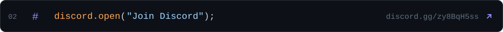
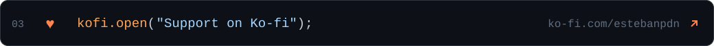
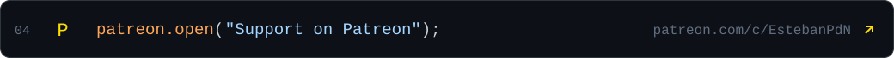

<picture>
  <source media="(prefers-color-scheme: dark)" srcset="assets/profile-card-dark.svg?v=stats-20261104-41972996640">
  <source media="(prefers-color-scheme: light)" srcset="assets/profile-card-light.svg?v=stats-20261104-41972996640">
  
</picture>

  <picture>
    <source media="(prefers-color-scheme: dark)" srcset="assets/info-support-heading-dark.svg?v=no-indent-20261104">
    <source media="(prefers-color-scheme: light)" srcset="assets/info-support-heading-light.svg?v=no-indent-20261104">
    
  </picture>
  <a href="https://estebanpdn.github.io/"><picture>
    <source media="(prefers-color-scheme: dark)" srcset="assets/link-website-dark.svg">
    <source media="(prefers-color-scheme: light)" srcset="assets/link-website-light.svg">
    
  </picture></a>
  <a href="https://discord.gg/zy8BqH5ss"><picture>
    <source media="(prefers-color-scheme: dark)" srcset="assets/link-discord-dark.svg">
    <source media="(prefers-color-scheme: light)" srcset="assets/link-discord-light.svg">
    
  </picture></a>
  <!-- <a href="https://ko-fi.com/estebanpdn"><picture>
    <source media="(prefers-color-scheme: dark)" srcset="assets/link-kofi-dark.svg">
    <source media="(prefers-color-scheme: light)" srcset="assets/link-kofi-light.svg">
    
  </picture></a> -->
  <a href="https://www.patreon.com/c/EstebanPdN"><picture>
    <source media="(prefers-color-scheme: dark)" srcset="assets/link-patreon-dark.svg">
    <source media="(prefers-color-scheme: light)" srcset="assets/link-patreon-light.svg">
    
  </picture></a>
  <picture>
    <source media="(prefers-color-scheme: dark)" srcset="assets/development-heading-dark.svg?v=no-indent-20261104">
    <source media="(prefers-color-scheme: light)" srcset="assets/development-heading-light.svg?v=no-indent-20261104">
    
  </picture>
  <picture>
    <source media="(prefers-color-scheme: dark)" srcset="assets/development-paragraph-dark.svg">
    <source media="(prefers-color-scheme: light)" srcset="assets/development-paragraph-light.svg">
    
  </picture>
  <a href="AI_DEVELOPMENT.md"><picture>
    <source media="(prefers-color-scheme: dark)" srcset="assets/development-process-dark.svg?v=no-indent-20261104">
    <source media="(prefers-color-scheme: light)" srcset="assets/development-process-light.svg?v=no-indent-20261104">
    
  </picture></a>
   

